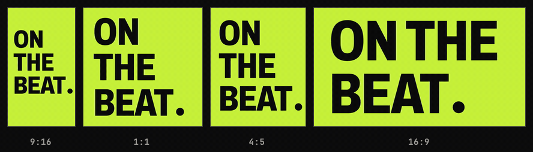
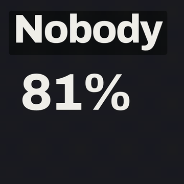
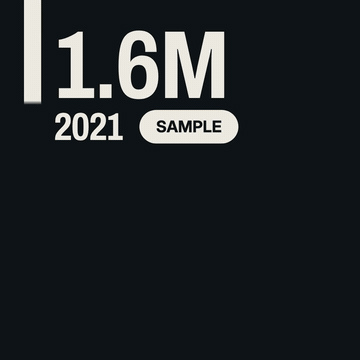
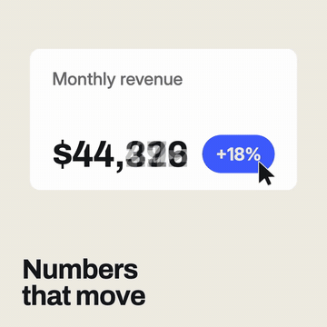
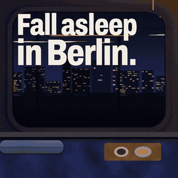
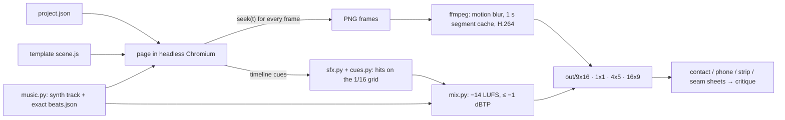
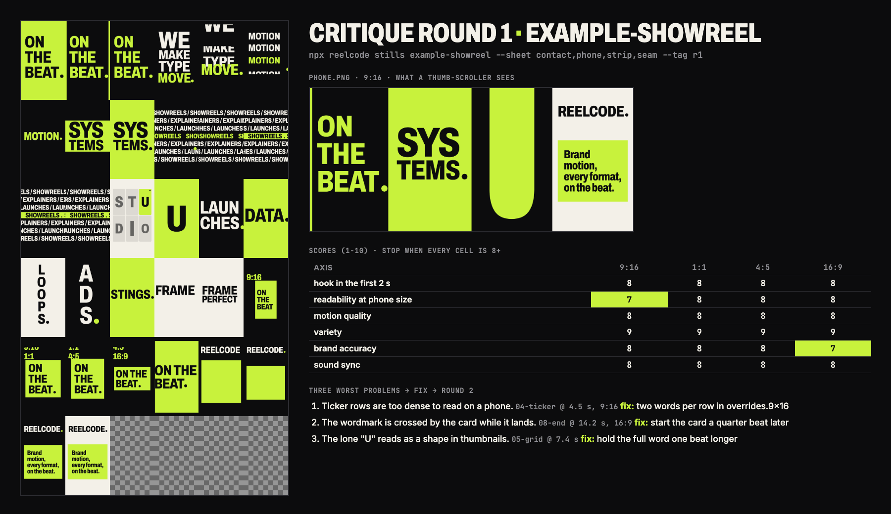

<p align="center">
  
</p>

<h1 align="center">reelcode</h1>

<p align="center"><b>A motion design studio your coding agent runs.</b><br>
<code>film = fn(t)</code>: <code>seek(t)</code> in, every format out, scored on the beat.</p>

<p align="center">
  <a href="LICENSE"></a>
  
  
  
</p>

---

**What is it, in three seconds:** you (or your coding agent) write a `project.json`. reelcode turns it into a short
motion-graphics film in four aspect ratios, with synthesized music, sound effects that land on the beat, a mix at
−14 LUFS, and contact sheets that a human or an agent can critique. Every frame is a pure function of time, so the
same project renders the same film every time.

## Quickstart

macOS or Linux, with Node 20+ (CI runs 22; also run locally on 26), ffmpeg and Python 3.12+ (or [uv](https://docs.astral.sh/uv/), which brings its
own Python):

```sh
git clone https://github.com/loehrning-ai/reelcode && cd reelcode
npm install                                   # one dependency: Playwright (nothing heavy runs here)
npx reelcode setup                            # Python venv, Chromium, fixture media; then a doctor check
npx reelcode make example-showreel            # → projects/example-showreel/out/<format>/draft.mp4
```

`npx` runs the copy inside the clone; nothing is fetched from the npm registry. Missing ffmpeg? `brew install ffmpeg`
or `sudo apt-get install -y ffmpeg`. `npx reelcode doctor` tells you what is missing and how to fix it.

Plan for about 1.2 GB of disk. The first `setup` downloads Playwright's Chromium (about 570 MB in Playwright's browser
cache) and the Python audio stack (numpy, scipy, librosa, numba: about 290 MB in `.venv/`, plus a similar amount in the
uv or pip cache). Setup took about 30 s with warm caches; with empty caches expect a minute or two on a fast line and longer on a slow one. Reruns skip
finished steps and take seconds. On a bare Linux box, `npx reelcode setup --with-deps` also installs Chromium's system libraries (sudo).
The first `make example-showreel` renders four formats of a 16 s film and takes two to three minutes on a laptop.
Linux gets the same code path and a CI job on `ubuntu-latest`, but the maintainer has only run it on macOS so far; if a command fails on your distro, `npx reelcode doctor` output in an issue is the fastest fix.

Make your own:

```sh
npx reelcode new --list                                   # the templates
npx reelcode new --template data-story --name q3-numbers  # scaffold projects/q3-numbers/project.json
$EDITOR projects/q3-numbers/project.json                  # your content, your brand
npx reelcode make q3-numbers                              # draft of every format, with sound and critique sheets
npx reelcode make q3-numbers --quality final              # 60 fps with motion blur: slow, see below
```

A final paints eight times the frames of a draft. All four formats of this 20 s film took about 20 minutes on an
Apple Silicon laptop that was busy with other work; add `--formats 9x16` to render one format first. Every
command prints its flags with `--help`.

## Ask your agent

reelcode ships as a plugin for Claude Code. The skill walks the agent through the whole loop: inputs, a shotlist on
the beat grid, a draft, a contact-sheet critique scored per format until every axis reaches 8, then the final.

```text
/plugin marketplace add loehrning-ai/reelcode
/plugin install reelcode@reelcode
```

Then, inside the clone: *"Make a 15 second launch film for our analytics app in 9:16 and 16:9, with a punchy synth
track."* Codex, Cursor and other agents can follow the same workflow from [docs/AGENTS_GUIDE.md](docs/AGENTS_GUIDE.md).

## Templates

| | |
|---|---|
|  |  |
| **product-launch**: real UI captures assemble, get clicked on the beat, and collapse into the logo | **data-story**: bar races, self-drawing lines and counters from plain numbers |
|  |  |
| **morph-loop**: one UI container that never cuts, as an exact loop | **social-ad**: photos or footage, captions, a price beat and a CTA, with variants and cutdowns |

The GIFs are made from the 1:1 finals (60 fps, with sound) of `projects/example-*`, at 10 to 12.5 fps and without sound. Every example renders in all four formats.

| Template | Makes |
|---|---|
| `showreel` | kinetic-type reel, a new type technique every shot, seamless loop |
| `product-launch` | launch film from captures of a local app (a mock app ships in `fixtures/`) |
| `data-story` | animated data story with locale-formatted numbers |
| `explainer` | 3 to 5 step how-it-works film around one travelling object |
| `morph-loop` | one container morphing through UI states, driven by a cursor |
| `logo-sting` | 2 to 5 s logo reveal with an audio logo; ProRes 4444 alpha |
| `lower-third` | broadcast straps and titles on a transparent canvas |
| `social-ad` | 6 to 20 s ad from photos or footage, with captions, variants and cutdowns |

Every template renders to 9:16, 1:1, 4:5 and 16:9. Details: [docs/TEMPLATES.md](docs/TEMPLATES.md).

## How it works



A template's `build(api)` returns scenes once per format; each scene's `draw(f)` is a pure function of the frame
object. The runtime bans the browser clock, timers and `Math.random` while rendering, and lint proves determinism by
seeking frames forwards, backwards, interleaved and on a fresh page and comparing hashes. Because a frame depends
only on `t`, reelcode can render formats in parallel, re-encode only the 1 s segments whose pixels changed, and
re-render a single passage. The details are in [docs/SPEC.md](docs/SPEC.md).

## What makes it different

- **Synth music, cut on the beat.** `music.py` writes the track and an exact beat grid from a style, key and seed,
  so the music is yours to publish. Scenes are measured in beats; sound effects are derived from the timeline and
  land within 10 ms of the 1/16 grid. Bring your own track and `beats.py` measures it instead.
- **−14 LUFS, measured.** Every mix is normalised and verified with ebur128 (−14 ±0.5 LUFS integrated, true peak
  ≤ −1 dBTP), then re-measured after muxing.
- **Four formats from one timeline.** 9:16, 1:1, 4:5 and 16:9 share one timeline and one mix; layouts adapt per
  format, safe areas clear the platform's own buttons. Variants (language, brand) and cutdowns (a 6 s edit from the
  same scenes) are fields, not copies.
- **Anti-slop lint.** Glow, gradient backgrounds, fade-only entrances, centred lone titles, particle bursts, frame
  borders, unreadable text, low contrast and long holds are caught by `reelcode lint`. [docs/HOUSE_RULES.md](docs/HOUSE_RULES.md).
- **A critique loop built in.** `stills` renders the sheets an agent can actually look at; the skill scores six axes
  per format and fixes the three worst problems each round until everything reaches 8.
- **Deterministic.** Same project, same machine setup, same pixels. Reruns with no changes leave `manifest.json`
  byte-identical, including every file hash.

<p align="center">
  
</p>
<p align="center"><sub>The two sheets are real <code>stills</code> output of <code>example-showreel</code>. The scores and fixes show the
shape of a round the skill writes; this panel was laid out for the README, not recorded from one agent run.</sub></p>

## How it compares

An honest comparison, as of October 2026. All three alternatives are mature tools with far larger communities;
reelcode is a 0.1 release with a narrow focus: short, branded, on-the-beat films that an agent can build and check.

| | reelcode | [Remotion](https://www.remotion.dev) | [Motion Canvas](https://motioncanvas.io) | After Effects |
|---|---|---|---|---|
| Authoring | JSON content + JS canvas templates | React components | TypeScript generators | GUI timeline, expressions |
| Licence | MIT | source-available; free for individuals, non-profits and companies with up to 3 employees, a paid company licence above that | MIT | proprietary subscription |
| Rendering | headless Chromium + ffmpeg, local | headless Chromium + ffmpeg, local or serverless | browser, image sequence or ffmpeg | desktop app, `aerender` |
| Preview editor | a scrubber page | Remotion Studio | full editor with timeline | full application |
| Music | synthesized per film, exact beat grid | bring your own | bring your own | bring your own |
| Sound design | derived from the timeline, on the 1/16 grid | by hand | by hand | by hand |
| Loudness | −14 LUFS mastered and verified | by hand | by hand | by hand |
| Aspect ratios | 4 from one timeline | one composition per size, by hand | by hand | by hand |
| Built-in lint and critique sheets | yes | no | no | no |
| Ecosystem, docs, community | small and new | large | medium | huge |

If you want a general video framework with a large ecosystem, use Remotion or Motion Canvas. If you want hand-made
motion design, use After Effects. reelcode is for when a coding agent should make the film and check its own work.

## FAQ

**Do I need Claude Code?** No. Everything is a CLI; the plugin only teaches an agent the workflow.

**Can I publish the films?** Yes. The music and effects are synthesized by your own run, the bundled fonts are SIL
OFL. Do not publish macOS `say` voice-over: Apple's licence does not cover it. Use your own recording (`file`
engine) or a licensed text-to-speech service.

**Windows?** Not tested. WSL2 with Ubuntu should behave like Linux.

**Are renders byte-identical across machines?** Within one machine setup, yes. Across operating systems, Chromium's
font rasterisation and ffmpeg builds differ slightly, so pixels can differ by a little; timing, frame counts and
loudness do not.

**How long does a render take?** Measured on an Apple Silicon laptop: a final (60 fps, four sub-frames of motion
blur per frame) of the 22 s launch film took about 10 minutes for 1:1 and 9:16 rendered in parallel, and all four
formats of the 20 s data-story template took about 20 minutes on a busy machine. A draft
(30 fps, no sub-frames) paints an eighth of the frames, so it is several times faster. Frame capture is the bottleneck
(see the roadmap). Unchanged 1 s segments come from the cache, so reruns after small edits are quick.

**Can it capture my app?** `reelcode capture` screenshots a local app (localhost or a file) into a project. It refuses
remote URLs and blocks every request outside the app's origin.

## Roadmap

- Faster frame capture (raw pixels instead of PNG screenshots)
- More templates: podcast clip, changelog, testimonial
- Piper or other open voice models as a built-in voice-over engine
- Windows support
- Publishing to npm once the CLI settles

## Credits

- Inspired by *How to Build a Motion Design Studio With Opus 5.5* by raycfu. No text or code from it is included.
- Built on [Playwright](https://playwright.dev) (Apache-2.0), [ffmpeg](https://ffmpeg.org), [numpy](https://numpy.org),
  [SciPy](https://scipy.org), [librosa](https://librosa.org), [soundfile](https://github.com/bastibe/python-soundfile)
  and [Numba](https://numba.pydata.org).
- Fonts: Archivo, Inter, JetBrains Mono, Jost and Space Grotesk, under the SIL Open Font License ([LICENSES/](LICENSES)).
- Full list: [THIRD_PARTY_NOTICES.md](THIRD_PARTY_NOTICES.md).

## Contributing

Issues and pull requests are welcome: [CONTRIBUTING.md](CONTRIBUTING.md). Security reports: [SECURITY.md](SECURITY.md).

---

<p align="center">Built by <a href="https://loehrning.ai">loehrning.ai</a> · MIT licence</p>
