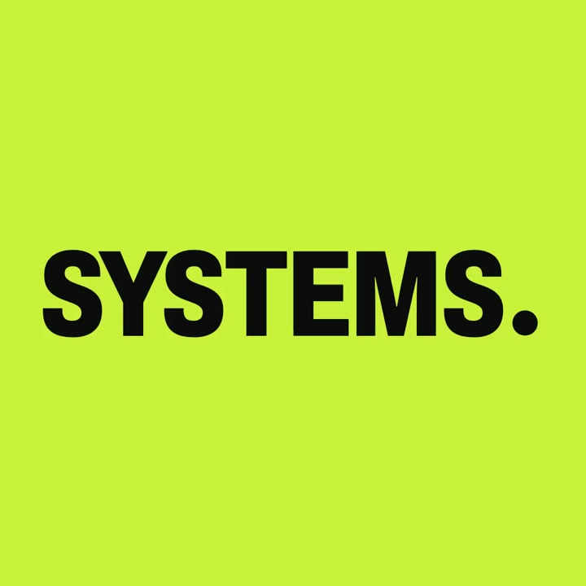
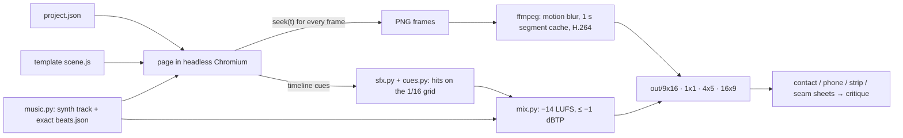

<h1 align="center">reelcode</h1>

<p align="center"><b>Write a <code>project.json</code>, run one command, get a 16 s motion film in 9:16, 1:1, 4:5 and 16:9,<br>
with synthesized music and sound effects on the beat, mixed to -14 LUFS.<br>
Built for coding agents to run and check their own work.</b></p>

<p align="center">
  <a href="LICENSE"></a>
  
  
  
</p>

<p align="center">
  <a href="docs/media/showreel-1x1.mp4"></a><br>
  <sub>The <code>example-showreel</code> film, 1:1, 16 s, 1.9 MB MP4 <b>with sound</b>. Click to open it, then turn the volume up: the cuts and the hits land on the beat.</sub>
</p>

> **Status: 0.1.** Tested on macOS (Apple Silicon). Linux runs in CI but is untested by hand. Windows is not supported.

## Try it

```sh
git clone https://github.com/loehrning-ai/reelcode && cd reelcode
npm install && npx reelcode setup && npx reelcode make example-showreel --formats 1x1
```

Expect about 1.2 GB of downloads once (Chromium and a Python audio stack) and two to four minutes for the first
16 s film. It worked when `projects/example-showreel/out/1x1/draft.mp4` plays with sound and `contact.png` sits next
to it. Drop `--formats 1x1` to render all four formats.

<details>
<summary><b>Requirements and timings</b></summary>

- Needs Node 20+ (CI runs 22), ffmpeg, and Python 3.12+ or [uv](https://docs.astral.sh/uv/), which brings its own Python.
  Missing ffmpeg? `brew install ffmpeg` or `sudo apt-get install -y ffmpeg`. `npx reelcode doctor` says what is missing.
- `npx` runs the copy inside the clone; nothing is fetched from the npm registry.
- Disk: about 570 MB for Playwright's Chromium (in its browser cache) and about 290 MB in `.venv/` for numpy, scipy, librosa
  and numba, plus a similar amount in the uv or pip cache. Setup took about 30 s with warm caches; with empty caches expect
  a minute or two on a fast line. Reruns skip finished steps and take seconds.
- On a bare Linux box, `npx reelcode setup --with-deps` also installs Chromium's system libraries (sudo). If a command
  fails on your distro, `npx reelcode doctor` output in an issue is the fastest fix.

| Render | What | Measured on an Apple Silicon laptop |
|---|---|---|
| draft (30 fps) | 16 s showreel, four formats | about two to four minutes, more if the machine is busy |
| final (`--quality final`, 60 fps, motion blur) | 20 s data-story, four formats | about 20 minutes on a busy machine |
| final | 22 s launch film, 1:1 and 9:16 in parallel | about 10 minutes |

A final paints eight times the frames of a draft, and frame capture is the bottleneck (see the roadmap). Add
`--formats 9x16` to render one format first. Unchanged 1 s segments come from a cache, so reruns after small edits are quick.

</details>

## Ask your agent

reelcode ships as a plugin for Claude Code. **The plugin teaches the agent the workflow; the engine lives in your
clone.** The skill walks the agent through inputs, a shotlist on the beat grid, a draft, a contact-sheet critique scored
per format until every axis reaches 8, then the final.

One paste that does the clone, the setup and a first film:

```text
Clone https://github.com/loehrning-ai/reelcode, run npx reelcode setup, then make example-showreel and show me the contact sheet.
```

Then add the plugin and ask for your own film:

```text
/plugin marketplace add loehrning-ai/reelcode
/plugin install reelcode@reelcode
```

> Make a 15 second launch film for our analytics app in 9:16 and 16:9, with a punchy synth track.

Codex, Cursor and other agents follow the same workflow without a plugin:

```text
Read docs/AGENTS_GUIDE.md, then make a 15 s launch film for <product> in 9:16 and 16:9.
```

What the agent does, in order (an outline of the skill's steps, not a recorded session):

1. Scaffolds `projects/<name>/project.json` from a template and fills in your copy, brand colours and captures.
2. Runs `npx reelcode make <name>`: a draft of every format, the music, the sound effects, the mix and the sheets.
3. Opens `contact.png`, `phone.png`, `strip.png` and `seam.png`, scores each format on six axes and writes down the three worst problems.
4. Edits `project.json`, re-runs, and repeats until every axis is 8 or better. Then `--quality final`.

Make your own by hand:

```sh
npx reelcode new --list                                   # the templates
npx reelcode new --template data-story --name q3-numbers  # scaffold projects/q3-numbers/project.json
$EDITOR projects/q3-numbers/project.json                  # your content, your brand
npx reelcode make q3-numbers                              # draft of every format, with sound and critique sheets
npx reelcode make q3-numbers --quality final              # 60 fps with motion blur: slow, see the timings above
```

Every command prints its flags with `--help`.

## Four formats from one timeline

<p align="center">
  
</p>

## Templates

| | |
|---|---|
|  |  |
| **product-launch**: real UI captures assemble, get clicked on the beat, and collapse into the logo | **data-story**: bar races, self-drawing lines and counters from plain numbers |

The GIFs are made from the 1:1 finals of `projects/example-*`, at about 10 to 12.5 fps and without sound, so mid-transition
frames look smeared; the MP4s are sharper. Every example renders in all four formats.

| Template | Makes |
|---|---|
| `showreel` | kinetic-type reel, a new type technique every shot, seamless loop |
| `product-launch` | launch film from captures of a local app (a mock app ships in `fixtures/`) |
| `data-story` | animated data story with locale-formatted numbers |
| `explainer` | 3 to 5 step how-it-works film around one travelling object |
| `morph-loop` | one container morphing through UI states, driven by a cursor, as an exact loop |
| `logo-sting` | 2 to 5 s logo reveal with an audio logo; ProRes 4444 alpha |
| `lower-third` | broadcast straps and titles on a transparent canvas |
| `social-ad` | 6 to 20 s ad from photos or footage, with captions, variants and cutdowns |

Every template renders to 9:16, 1:1, 4:5 and 16:9. Details: [docs/TEMPLATES.md](docs/TEMPLATES.md).

## How it works

The idea is `film = fn(t)`: `seek(t)` in, every format out, scored on the beat.



A template's `build(api)` returns scenes once per format; each scene's `draw(f)` is a pure function of the frame
object. The runtime bans the browser clock, timers and `Math.random` while rendering, and lint proves determinism by
seeking frames forwards, backwards, interleaved and on a fresh page and comparing hashes. Because a frame depends
only on `t`, reelcode can render formats in parallel, re-encode only the 1 s segments whose pixels changed, and
re-render a single passage. The details are in [docs/SPEC.md](docs/SPEC.md).

## What makes it different

- **Synth music, cut on the beat.** `music.py` writes the track and an exact beat grid from a style, key and seed,
  so the music is yours to publish. Scenes are measured in beats; sound effects are derived from the timeline and
  land within 10 ms of the 1/16 grid. Bring your own track and `beats.py` measures it instead.
- **-14 LUFS, measured.** Every mix is normalised and verified with ebur128 (-14 ±0.5 LUFS integrated, true peak
  <= -1 dBTP), then re-measured after muxing.
- **Four formats from one timeline.** 9:16, 1:1, 4:5 and 16:9 share one timeline and one mix; layouts adapt per
  format, safe areas clear the platform's own buttons. Variants (language, brand) and cutdowns (a 6 s edit from the
  same scenes) are fields, not copies.
- **Lint for common motion-design tells.** `reelcode lint` flags glow, gradient backgrounds, fade-only entrances, centred
  lone titles, particle bursts, frame borders, unreadable text, low contrast and long holds, and checks that frames are
  deterministic. These are rules we chose, listed in [docs/HOUSE_RULES.md](docs/HOUSE_RULES.md); they are not a taste oracle.
- **Sheets an agent can look at.** `stills` renders contact, phone, strip and seam sheets; the skill scores six axes
  per format and fixes the three worst problems each round until everything reaches 8.
- **Deterministic.** Same project, same machine setup, same pixels. Reruns with no changes leave `manifest.json`
  byte-identical, including every file hash.

<p align="center">
  
</p>
<p align="center"><sub><b>Illustration, not a recording.</b> The two sheets are real <code>stills</code> output of <code>example-showreel</code>. The scores and fixes show the
shape of a round the skill writes; this panel was laid out for the README, not recorded from one agent run.</sub></p>

## Limitations

- No GUI editor: you edit `project.json` and watch a scrubber page.
- Templates only: there is no free-form timeline authoring.
- Finals are slow (about 20 minutes for four formats of a 20 s film), drafts take a few minutes.
- No Windows support; Linux is covered by CI but untested by hand.
- The critique-loop figure above is an illustration, not a recorded agent run.
- The `explainer` voice-over variant needs macOS `say`, so it is for drafts on macOS only; no `say` audio ships in this repo.

## FAQ

**Do I need Claude Code?** No. Everything is a CLI; the plugin only teaches an agent the workflow, and the engine always lives in your clone.

**Can I publish the films?** Yes. The music and effects are synthesized by your own run, the bundled fonts are SIL
OFL. Do not publish macOS `say` voice-over: Apple's licence does not cover it. Use your own recording (`file`
engine) or a licensed text-to-speech service.

**Windows?** Not supported. WSL2 with Ubuntu should behave like Linux.

**Are renders byte-identical across machines?** Within one machine setup, yes. Across operating systems, Chromium's
font rasterisation and ffmpeg builds differ slightly, so pixels can differ by a little; timing, frame counts and
loudness do not.

**How long does a render take?** See the timings table under Try it.

**Can it capture my app?** `reelcode capture` screenshots a local app (localhost or a file) into a project. It refuses
remote URLs and blocks every request outside the app's origin.

## How it compares

An honest comparison, as of October 2026. All three alternatives are mature tools with far larger communities;
reelcode is a 0.1 release with a narrow focus: short, branded, on-the-beat films that an agent can build and check.

| | reelcode | [Remotion](https://www.remotion.dev) | [Motion Canvas](https://motioncanvas.io) | After Effects |
|---|---|---|---|---|
| Authoring | JSON content + JS canvas templates | React components | TypeScript generators | GUI timeline, expressions |
| Licence | MIT | source-available; free for individuals, non-profits and companies with up to 3 employees, a paid company licence above that | MIT | proprietary subscription |
| Rendering | headless Chromium + ffmpeg, local | headless Chromium + ffmpeg, local or serverless | browser, image sequence or ffmpeg | desktop app, `aerender` |
| Preview editor | a scrubber page | Remotion Studio | full editor with timeline | full application |
| Music | synthesized per film, exact beat grid | bring your own | bring your own | bring your own |
| Sound design | derived from the timeline, on the 1/16 grid | by hand | by hand | by hand |
| Loudness | −14 LUFS mastered and verified | by hand | by hand | by hand |
| Aspect ratios | 4 from one timeline | one composition per size, by hand | by hand | by hand |
| Lint and critique sheets, out of the box | yes | no | no | no |
| Ecosystem, docs, community | small and new | large | medium | huge |

If you want a general video framework with a large ecosystem, use Remotion or Motion Canvas. If you want hand-made
motion design, use After Effects. reelcode is for when a coding agent should make the film and check its own work.

## Roadmap

Final renders take about 20 minutes for four formats, so speed comes first.

- Faster frame capture (raw pixels instead of PNG screenshots)
- More templates: podcast clip, changelog, testimonial
- Piper or other open voice models as a built-in voice-over engine
- Windows support
- Publishing to npm once the CLI settles

## Credits

- Inspired by *How to Build a Motion Design Studio With Opus 5.5* by raycfu. No text or code from it is included.
- Built on [Playwright](https://playwright.dev) (Apache-2.0), [ffmpeg](https://ffmpeg.org), [numpy](https://numpy.org),
  [SciPy](https://scipy.org), [librosa](https://librosa.org), [soundfile](https://github.com/bastibe/python-soundfile)
  and [Numba](https://numba.pydata.org).
- Fonts: Archivo, Inter, JetBrains Mono, Jost and Space Grotesk, under the SIL Open Font License ([LICENSES/](LICENSES)).
- Full list: [THIRD_PARTY_NOTICES.md](THIRD_PARTY_NOTICES.md).

## Contributing

Issues and pull requests are welcome: [CONTRIBUTING.md](CONTRIBUTING.md). Security reports: [SECURITY.md](SECURITY.md).

---

<p align="center">Built by <a href="https://loehrning.ai">loehrning.ai</a> · MIT licence</p>
