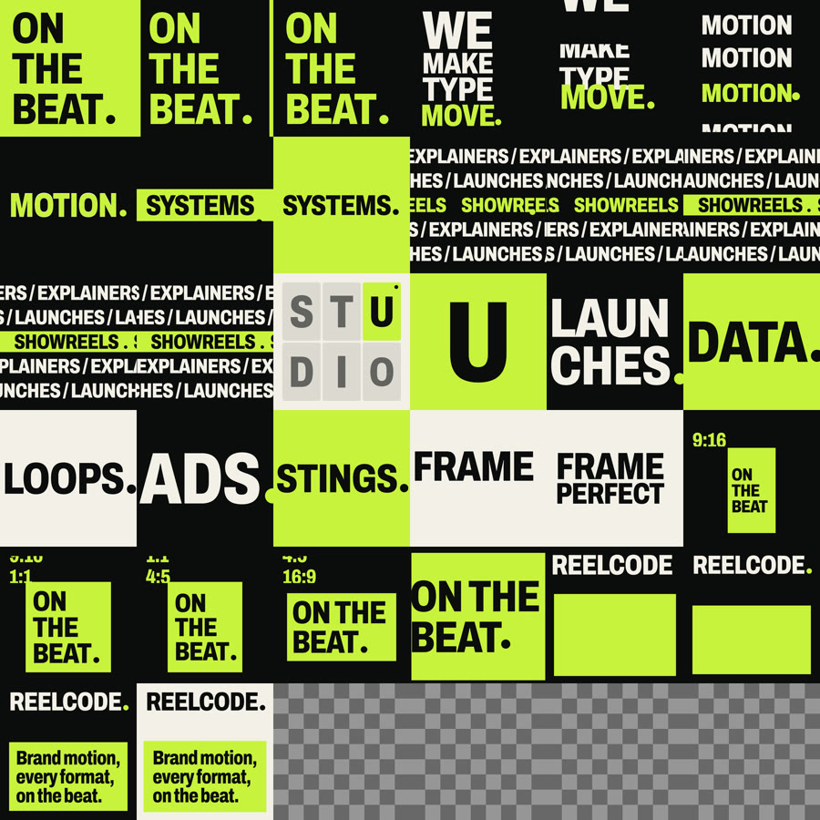
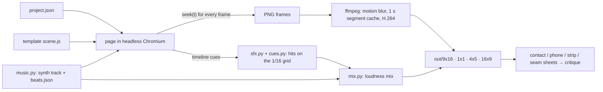

<h1 align="center">reelcode</h1>

<p align="center"><b>Write a JSON file. Get a 15 s motion film with music, in 9:16, 1:1, 4:5 and 16:9, rendered from one timeline in headless Chromium. Built to be run by a coding agent.</b></p>

<p align="center">
  
  
  
  
  
</p>

<table>
<tr>
<td width="50%" valign="top">

`projects/example-showreel/project.json` (excerpt)

```json
{
  "template": "showreel",
  "brand": { "name": "reelcode",
    "colors": { "bg": "#0C0C0D",
      "fg": "#F3F0E8", "accent": "#C8F23C" } },
  "content": { "shots": [
    { "technique": "scale", "beats": 2,
      "text": "ON THE BEAT" },
    { "technique": "kinetic", "beats": 3,
      "lines": ["WE MAKE", "TYPE MOVE"],
      "accent": "MOVE" } ] }
}
```

</td>
<td width="50%" valign="top">


</td>
</tr>
</table>

<p align="center"><a href="docs/media/showreel-1x1.mp4"><b>Watch it with sound (16 s, 1.9 MB MP4)</b></a><br>
<sub>The whole film, music and sound effects included, came out of one <code>project.json</code>. The GIF is silent.</sub></p>

**What it is:** a command-line renderer with eight film templates, a music and sound-effect synthesizer, and a critique loop
for coding agents. **What it is not:** a video editor, a GUI, a Remotion replacement, or a free-form timeline.

## Try it

```sh
git clone https://github.com/loehrning-ai/reelcode && cd reelcode
npm install && npx reelcode setup && npx reelcode make example-showreel --formats 1x1
```

Honest cost: the first run downloads about 1.2 GB (Chromium and a Python audio stack) and takes two to four minutes. It
needs Node 20+, ffmpeg and Python 3.12+ or [uv](https://docs.astral.sh/uv/); `npx reelcode doctor` checks them before the
big download. The 1:1 draft above took **51 s** on an Apple Silicon laptop with no cached segments. All four formats take
a few minutes; 60 fps finals take about 20 minutes ([timings](docs/REQUIREMENTS.md)).

The last command ends like this (`npx` runs the copy inside the clone, nothing comes from the npm registry):

```text
make: mix: 16.000s to -14 LUFS
make: lint: --fast on 1x1
1x1     projects/example-showreel/out/1x1/draft.mp4  480  30  16.000s  -14.0  -2.7
lint: pass  manifest: projects/example-showreel/out/manifest.json
```

Open `draft.mp4` (with sound) and `contact.png` next to it. This is the contact sheet the agent critiques:

<p align="center"></p>

**Status:** 0.1, verified on macOS (Apple Silicon). Linux runs in CI but is untested by hand. Windows is not supported.

## Why

- **Audio comes from the timeline.** `music.py` writes the track and an exact beat grid; sound effects are derived from the
  scene cues, and the mix is measured at -14 LUFS. The music is synthesized by your run, so it is yours to publish.
  Commands and printed output: [docs/VERIFY.md](docs/VERIFY.md).
- **One timeline, four formats.** 9:16, 1:1, 4:5 and 16:9 share one timeline and one mix, with per-format layouts and safe areas.
- **Pure `fn(t)` rendering with a determinism lint.** `reelcode lint` re-seeks frames forwards, backwards and on a fresh page
  and compares hashes. Same project and same machine setup give the same pixels ([FAQ](docs/FAQ.md)).

Why not [Remotion](https://www.remotion.dev)? It is a mature video framework for people who write React, with a far larger
ecosystem. reelcode is narrower: templated films a coding agent runs, with music, sound design and loudness built in
([comparison](docs/COMPARISON.md)).

One timeline in four formats, silent:

<p align="center"></p>

## Ask your agent

reelcode ships as a plugin for Claude Code. **The plugin teaches the agent the workflow; the engine lives in your clone,
so start the agent inside the clone.**

```text
git clone https://github.com/loehrning-ai/reelcode && cd reelcode && npm install && npx reelcode setup
/plugin marketplace add loehrning-ai/reelcode
/plugin install reelcode@reelcode
> Make a 15 second launch film for our analytics app in 9:16 and 16:9.
```

Codex, Cursor and other agents follow the same workflow without a plugin. Paste this into the agent:

```text
Read docs/AGENTS_GUIDE.md, then make a 15 s launch film for <product> in 9:16 and 16:9.
```

What the skill has the agent do (an outline of its steps, not a recorded session):

1. Scaffolds `projects/<name>/project.json` from a template and fills in your copy, brand colours and captures.
2. Runs `npx reelcode make <name>`: a draft of every format, the music, the sound effects, the mix and the sheets.
3. Opens `contact.png`, `phone.png`, `strip.png` and `seam.png`, scores each format on six axes and writes down the three worst problems.
4. Edits `project.json`, re-runs, and repeats until every axis is 8 or better. Then `--quality final`.

The scores are the agent's own judgement, not a benchmark. Nothing here has been measured against human raters.

Make your own by hand:

```sh
npx reelcode new --list                                   # the templates
npx reelcode new --template data-story --name q3-numbers  # scaffold projects/q3-numbers/project.json
$EDITOR projects/q3-numbers/project.json                  # your content, your brand
npx reelcode make q3-numbers                              # draft of every format, with sound and critique sheets
npx reelcode make q3-numbers --quality final              # 60 fps with motion blur: slow
```

Every command prints its flags with `--help`. Made something? Post it with `#reelcode`.

## Templates

| | |
|---|---|
|  |  |
| **product-launch**: real UI captures assemble, get clicked on the beat, and collapse into the logo | **data-story**: bar races, self-drawing lines and counters from plain numbers |

The GIFs are made from the 1:1 finals of `projects/example-*`, at about 10 to 12.5 fps and without sound, so mid-transition
frames look smeared. Every example renders in all four formats.

| Template | Makes |
|---|---|
| `showreel` | kinetic-type reel, a new type technique every shot, seamless loop |
| `product-launch` | launch film from captures of a local app (a mock app ships in `fixtures/`) |
| `data-story` | animated data story with locale-formatted numbers |
| `explainer` | 3 to 5 step how-it-works film around one travelling object |
| `morph-loop` | one container morphing through UI states, driven by a cursor, as an exact loop |
| `logo-sting` | 2 to 5 s logo reveal with an audio logo; ProRes 4444 alpha |
| `lower-third` | broadcast straps and titles on a transparent canvas |
| `social-ad` | 6 to 20 s ad from photos or footage, with captions, variants and cutdowns |

Every template renders to 9:16, 1:1, 4:5 and 16:9. Details: [docs/TEMPLATES.md](docs/TEMPLATES.md).

## How it works

The idea is `film = fn(t)`: a frame depends only on `t`, so `seek(t)` in gives every format out.



A template's `build(api)` returns scenes once per format; each scene's `draw(f)` is a pure function of the frame
object. The runtime bans the browser clock, timers and `Math.random` while rendering, and lint proves determinism by
seeking frames forwards, backwards, interleaved and on a fresh page and comparing hashes. Because a frame depends
only on `t`, reelcode can render formats in parallel, re-encode only the 1 s segments whose pixels changed, and
re-render a single passage. The details are in [docs/SPEC.md](docs/SPEC.md).

## Limitations

- No GUI editor: you edit `project.json` and watch a scrubber page.
- Templates only: there is no free-form timeline authoring.
- Finals are slow (about 20 minutes for four formats of a 20 s film); drafts take a few minutes.
- No Windows support; Linux is covered by CI but untested by hand.
- The agent loop has not been recorded or benchmarked; scores are the agent's own judgement.
- The lint rules in [docs/HOUSE_RULES.md](docs/HOUSE_RULES.md) are choices we made, not a taste oracle.
- The `explainer` voice-over variant needs macOS `say`, so it is for drafts on macOS only; no `say` audio ships in this repo.

More: [FAQ](docs/FAQ.md), [comparison with Remotion, Motion Canvas and After Effects](docs/COMPARISON.md).

## Roadmap

Final renders take about 20 minutes for four formats, so speed comes first.

- Faster frame capture (raw pixels instead of PNG screenshots)
- More templates: podcast clip, changelog, testimonial
- Piper or other open voice models as a built-in voice-over engine
- Windows support
- Publishing to npm once the CLI settles

## Credits

- Inspired by *How to Build a Motion Design Studio With Opus 5.5* by raycfu. No text or code from it is included.
- Built on [Playwright](https://playwright.dev) (Apache-2.0), [ffmpeg](https://ffmpeg.org), [numpy](https://numpy.org),
  [SciPy](https://scipy.org), [librosa](https://librosa.org), [soundfile](https://github.com/bastibe/python-soundfile)
  and [Numba](https://numba.pydata.org).
- Fonts: Archivo, Inter, JetBrains Mono, Jost and Space Grotesk, under the SIL Open Font License ([LICENSES/](LICENSES)).
- Full list: [THIRD_PARTY_NOTICES.md](THIRD_PARTY_NOTICES.md).

## Contributing

Issues and pull requests are welcome: [CONTRIBUTING.md](CONTRIBUTING.md). Security reports: [SECURITY.md](SECURITY.md).

---

<p align="center">Built by <a href="https://loehrning.ai">loehrning.ai</a> · MIT licence</p>
